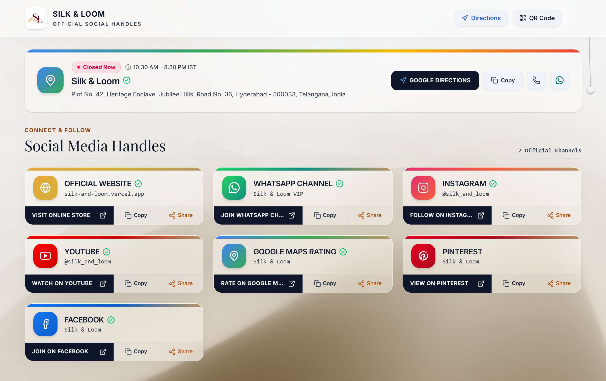
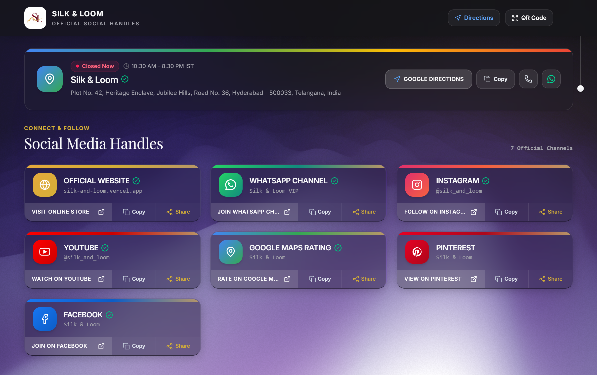
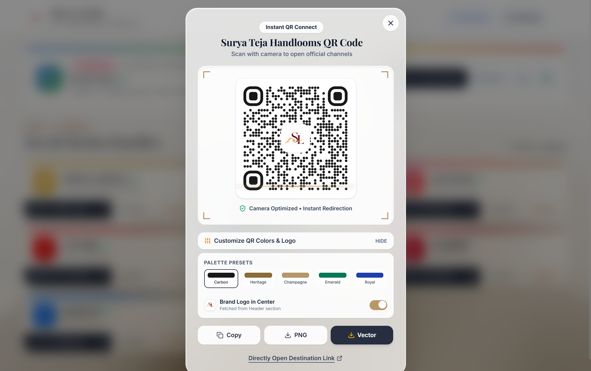
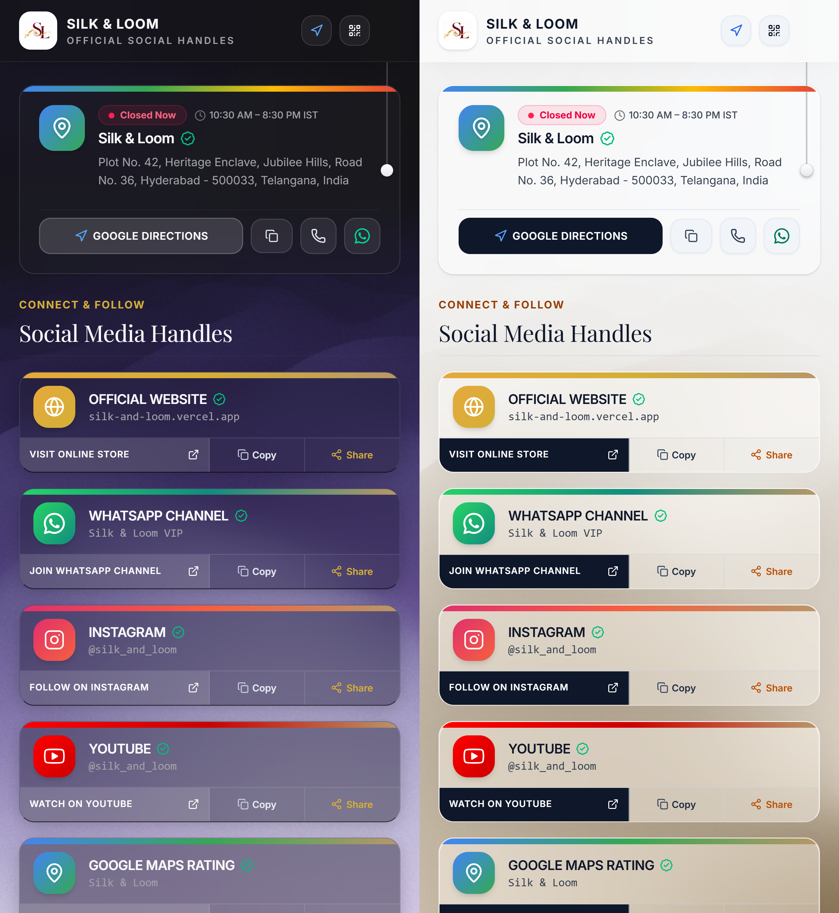

# 🪡 Silk & Loom Connect: Link-in-Bio & QR Hub

> An interactive **link-in-bio page with a dynamic QR code generator** for a handloom saree brand, built with React 19, TypeScript, Tailwind CSS v4, WebGL shaders, and Framer Motion.
>
> _Silk & Loom is a fictional demo brand created for portfolio purposes. All social handles, links, phone numbers, and addresses are placeholders._

[](https://react.dev/)
[](https://www.typescriptlang.org/)
[](https://vitejs.dev/)
[](https://tailwindcss.com/)
[](https://www.framer.com/motion/)
[](LICENSE)

---

## 📸 Screenshots

| Light Mode | Dark Mode |
| :---: | :---: |
|  |  |

| QR Code Generator | Mobile View |
| :---: | :---: |
|  |  |

---

## 🌐 Live Demo

- **Live site:** [https://silk-loom-connect.vercel.app](https://silk-loom-connect.vercel.app)
- **Companion storefront:** [saree-store-frontend](https://github.com/s-akhil-08/saree-store-frontend)
- **Backend API:** [saree-store-backend](https://github.com/s-akhil-08/saree-store-backend)

> [!NOTE]
> If the backend is asleep (free-tier hosting), the page shows built-in sample data instead, so it always renders.

---

## ✨ Features

### 🎨 Glassmorphic Design
- Layered backdrop blurs, soft highlights, and a gold-and-carbon colour palette
- **Framer Motion** spring animations, card hover glows, and confetti feedback

### 💡 Interactive Pull-Cord Theme Switcher
- A ceiling cord that retracts as you scroll down and extends as you scroll up, synchronized with `requestAnimationFrame`
- **Web Audio API** click-and-latch sound generated in code on every theme toggle (no audio files)

### 🌊 WebGL Ambient Waves
- Real-time wave shader built with **OGL / Three.js**
- Mouse parallax, and colours that adapt between light and dark themes

### 📍 Timezone-Aware Directions Card
- Calculates whether the studio is currently open, with a configurable weekly-off day
- Converts opening hours to the visitor's local timezone (from their device) alongside IST
- One-tap Google Maps directions and copy-address button with toast feedback

### 📱 Dynamic QR Code Generator
- Live QR code with export as **SVG** or **PNG up to 1200 px**
- Foreground and background colour pickers, logo overlay toggle, and scan/click analytics

### 🔗 Categorized Link Directory
- Filter tabs: **All**, **Social**, **VIP Direct** (WhatsApp), **Store & Reviews**, **Lookbook** (Pinterest), and **Media** (YouTube)

### 🔌 Offline-Friendly API Layer
- Fetches channel data and logs link clicks from the Django REST backend (`/api/hub/data/`, `/api/hub/track-click/`)
- Falls back to local mock data automatically when the API is unreachable

---

## 🛠️ Tech Stack

| Layer | Technology |
| :--- | :--- |
| Framework | [React 19](https://react.dev/) + [TypeScript](https://www.typescriptlang.org/) |
| Build | [Vite 6](https://vitejs.dev/) + [@tailwindcss/vite](https://tailwindcss.com/) |
| Styling | Tailwind CSS v4 + custom CSS glass variables |
| Animation | [Framer Motion 12](https://www.framer.com/motion/) + [Canvas Confetti](https://www.npmjs.com/package/canvas-confetti) |
| 3D / Shaders | [OGL](https://github.com/oframe/ogl) / [Three.js](https://threejs.org/) |
| Components | [Lucide React](https://lucide.dev/), [PullCord](https://www.npmjs.com/package/pullcord), [QRCode.react](https://www.npmjs.com/package/qrcode.react) |

---

## 📁 Project Structure

```text
silk-loom-connect/
├── public/                      # Favicons, brand logo, robots.txt, sitemap.xml
├── src/
│   ├── assets/
│   ├── components/
│   │   ├── AmbientBackground.tsx    # WebGL canvas and ambient glow
│   │   ├── GradientWaves.tsx        # OGL wave shader
│   │   ├── Header.tsx               # Glass navbar and quick actions
│   │   ├── GoogleDirectionCard.tsx  # Studio hours and directions
│   │   ├── SocialCard.tsx           # Link cards with animations
│   │   ├── SocialIcons.tsx          # Channel icons
│   │   ├── QRCodeModal.tsx          # QR generator and exporter
│   │   ├── MobileShareModal.tsx     # Web Share API dialog
│   │   ├── ErrorOfflinePage.tsx     # Offline page
│   │   └── SkeletonLoader.tsx       # Loading skeletons
│   ├── context/
│   │   ├── ThemeContext.tsx         # Dark / light / system theme
│   │   └── ToastContext.tsx         # Toast notifications
│   ├── data/
│   │   └── mockSocialData.ts        # Fallback demo channel data
│   ├── services/
│   │   └── api.ts                   # API client and click tracking
│   ├── App.tsx                      # App root and pull-cord
│   ├── main.tsx
│   ├── index.css                    # Tailwind directives and themes
│   └── types.ts                     # TypeScript interfaces
├── .env.example
├── .gitignore
├── package.json
├── tsconfig.json
└── vite.config.ts
```

---

## 🚀 Getting Started

**Prerequisites:** Node.js 18+ and npm (or yarn / pnpm).

```bash
# 1. Clone
git clone https://github.com/s-akhil-08/silk-loom-connect.git
cd silk-loom-connect

# 2. Install
npm install

# 3. (Optional) connect to a backend
cp .env.example .env

# 4. Run
npm run dev
```

Open [http://localhost:5173](http://localhost:5173).

**Environment variable** (optional, the app works without it using mock data):

```env
VITE_API_URL=https://your-backend-service-name.onrender.com
```

**Production build:**

```bash
npm run build     # output in dist/
npm run preview   # preview the build locally
```

---

## 🌐 Deployment (Vercel)

1. Push the repo to GitHub.
2. Import it on [Vercel](https://vercel.com) and set the project name (for example `silk-loom-connect`).
3. Add `VITE_API_URL` if you use a backend, then deploy. Vercel builds with `npm run build`.

---

## 💡 Design Decisions

- **Mock-data fallback** so the page always renders, even when free-tier hosting is asleep.
- **Sound generated with the Web Audio API** instead of audio files, which keeps the bundle small.
- **Timezone conversion on the client** using the visitor's device settings, avoiding any location lookup or extra requests.

---


## 📄 License

Licensed under the [MIT License](LICENSE).
